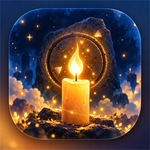
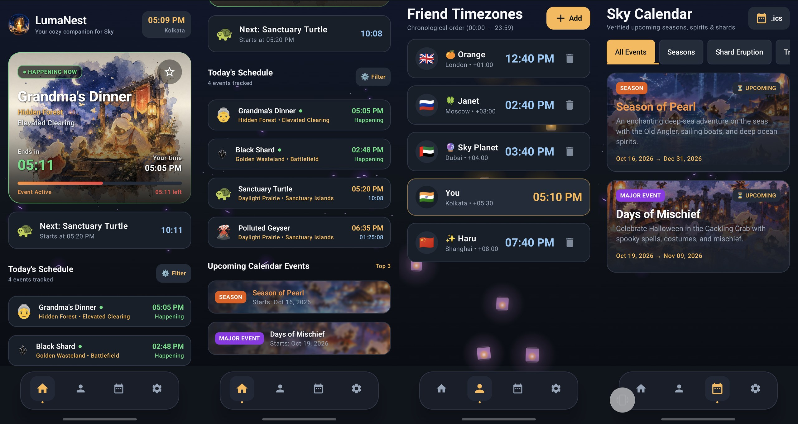

  

  # LumaNest 🌌
  ### *Your cozy, offline-first companion for Sky: Children of the Light*

  
  
  
  

   

  

 

---

## 📖 About LumaNest

**LumaNest** is an unofficial, standalone Android companion app crafted with love for players of **Sky: Children of the Light**. 

Built with a cozy dark midnight aesthetic and watercolor artwork, LumaNest brings all in-game timing systems, shard eruption calculations, multi-realm calendars, and friend timezones together into a single, offline-first experience—with zero ads, zero accounts, and zero tracking.

---

## ✨ Features

### 🕰️ Dynamic Sky Clock & Wax Cycles
* **Real-time Event Tracking:** Live countdowns and progress bars for **Polluted Geyser**, **Grandma's Dinner**, and **Sanctuary Turtle**.
* **Daily & Weekly Resets:** Accurate tracking for midnight quest refreshes and the Sunday Eden statue reset.
* **Smart Event Filtering:** Customize which events appear on your dashboard with a single tap.

### 🌋 Shard Eruption Engine (Plutoy Algorithm)
* **Mathematical Precision:** Calculates Red and Black shard landings, locations, and time windows up to 10 years in advance.
* **Ascended Candle (AC) Payouts:** Shows exact expected AC yields and memory locations.
* **Clean Visuals:** Crisp, transparent Red and Black crystal cluster emojis.

### 🎨 Ambient Calendar & Big Events
* **Cinematic Event Cards:** Upcoming seasons and festivals (like *Season of Pearl* and *Days of Mischief*) feature ambient frosted-glass artwork backdrops with smooth glowing gradients.
* **Verified Accuracy:** All big events are strictly cross-referenced against official TGC announcements, the SkyDreamers Notion Calendar, and Sky-Planner.
* **Cloud OTA Sync (Over-The-Air):** The app silently syncs newly revealed Traveling Spirits and official event dates on app open—zero APK updates required!

### 🌍 Friend Timezones Across the World
* **Global Sky Coordination:** Add friends with their country flags and timezones to see their local time instantly compared to Sky Standard Time.
* **Custom Ordering:** Drag, re-order, and manage your friend cards seamlessly.

### 📱 Sky Running Mode & Glance Widgets
* **Minimal Floating Countdown:** Enable floating overlay mode to track timers while playing Sky inside the game.
* **Clean Emoji Timers:** Minimal, borderless floating emojis with deep drop shadows that float cleanly over the game without obstructing your view.
* **Home Screen Widgets:** Place beautiful Jetpack Glance widgets on your Android launcher for next-event alerts and seasonal countdowns.

---

## 🔒 Offline-First & Privacy by Design

* **100% Local Storage:** All custom friend names, timezones, and favorites live exclusively in your local SQLite/Room database.
* **Zero Tracking:** No analytics SDKs, no user accounts, no telemetry, and no advertisements.
* **Graceful Offline Mode:** Never crashes or freezes without internet—works completely offline.

---

## 📥 Download & Installation

1. Head over to the **[Latest Releases](https://github.com/kakdamba/LumaNest-Sky-clock-and-calendar/releases/latest)** page.
2. Download the latest `LumaNest-V.X.apk`.
3. Open the downloaded file on your Android device and tap **Install** *(ensure "Install from unknown sources" is enabled in your browser)*.

---

## 🛠️ Architecture & Tech Stack

| Layer | Technology |
| :--- | :--- |
| **Language** | Kotlin 2.0+ with Coroutines & Flow |
| **UI Framework** | Jetpack Compose & Material 3 |
| **Database** | Room DB (SQLite) |
| **Widgets** | Jetpack Glance (AppWidget) |
| **Time Engine** | `java.time` (JSR-310) pegged to `America/Los_Angeles` (PST/PDT) |
| **Minimum SDK** | Android 8.0 (API 26) |
| **Target SDK** | Android 15 (API 35) |

---

## 📜 Disclaimer

LumaNest is an independent fan project and is **not affiliated with, endorsed by, or sponsored by thatgamecompany (TGC)**.  
*Sky: Children of the Light* and all associated characters, items, and assets are trademarks and copyright of thatgamecompany.

---

## ☕ Support & Community

Built with 🍊 and 🌻 by **KAKDAMBA**

* 🥣 **Buy me a Kheer:** [buymeacoffee.com/kakdamba](https://buymeacoffee.com/kakdamba)
* 📺 **YouTube Channel:** [@kakdambaa](https://www.youtube.com/@kakdambaa?sub_confirmation=1)
