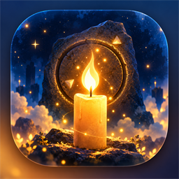
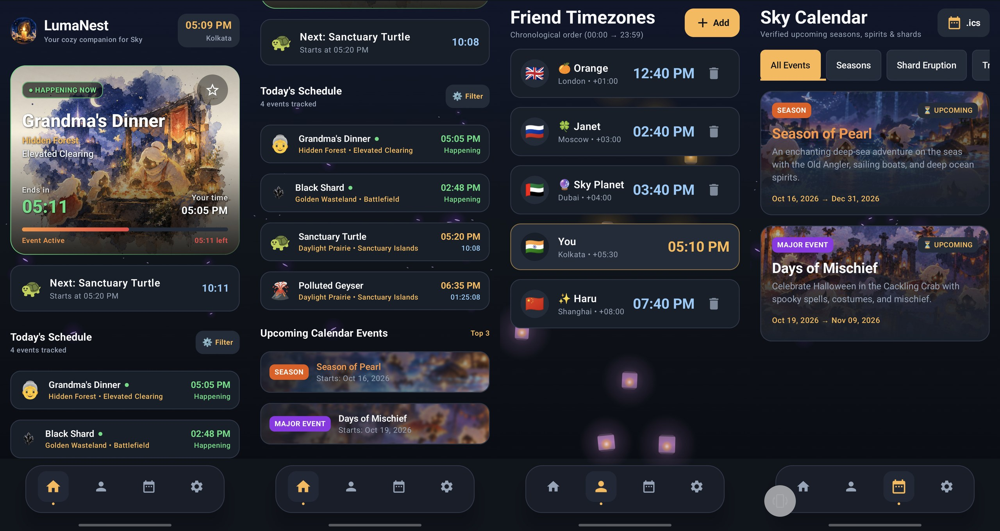

  

  # LumaNest 🌌
  ### *Your cozy, offline-first companion for Sky: Children of the Light*

  
  
  
  

   

  

 

---

## 📖 About LumaNest

**LumaNest** is an unofficial, standalone companion app crafted with love for players of **Sky: Children of the Light** on **Android and Windows PC**. 

Built with a cozy dark midnight aesthetic and watercolor artwork, LumaNest brings all in-game timing systems, shard eruption calculations, multi-realm calendars, and friend timezones together into a single, offline-first experience—with zero ads, zero accounts, and zero tracking.

---

## ✨ Features

### 🕰️ Dynamic Sky Clock & Wax Cycles
* **Real-time Event Tracking:** Live countdowns and progress bars for **Polluted Geyser**, **Grandma's Dinner**, and **Sanctuary Turtle**.
* **Daily & Weekly Resets:** Accurate tracking for midnight quest refreshes and the Sunday Eden statue reset.
* **Smart Event Filtering:** Customize which events appear on your dashboard with a single tap.

### 🌋 Shard Eruption Engine (Plutoy Algorithm)
* **Mathematical Precision:** Calculates Red and Black shard landings, locations, and time windows up to 10 years in advance.
* **Ascended Candle (AC) Payouts:** Shows exact expected AC yields and memory locations.
* **Clean Visuals:** Crisp, transparent Red and Black crystal cluster emojis.

### 🎨 Ambient Calendar & Big Events
* **Cinematic Event Cards:** Upcoming seasons and festivals (like *Season of Pearl* and *Days of Mischief*) feature ambient frosted-glass artwork backdrops with smooth glowing gradients.
* **Verified Accuracy:** All big events are strictly cross-referenced against official TGC announcements, the SkyDreamers Notion Calendar, and Sky-Planner.
* **Cloud OTA Sync (Over-The-Air):** The app silently syncs newly revealed Traveling Spirits and official event dates on app open—zero manual updates required!

### 🌍 Friend Timezones Across the World
* **Global Sky Coordination:** Add friends with their country flags and timezones to see their local wall-clock time instantly compared to your own and Sky Standard Time.
* **Vector Country Flag Badges:** Crisp, colorful country badges across 32+ global timezones.
* **Custom Ordering:** Re-order and manage your friend cards seamlessly.

### 📱 In-Game Floating Timers & Android Widgets
* **Live In-Game Overlay:** Enable floating overlay mode to track timers while playing Sky directly on your phone or PC (supporting Wing Arc meter, wall-to-wall bottom bar, and floating emoji timers with automatic game detection).
* **Clean Emoji Timers:** Minimal, borderless floating emojis with deep drop shadows that float cleanly over the game without obstructing your view.
* **Android Home Screen Widgets:** Place beautiful Jetpack Glance widgets on your Android launcher for next-event alerts and seasonal countdowns.

---

## 🔒 Offline-First & Privacy by Design

* **100% Local Storage:** All custom friend names, timezones, and preferences live exclusively on your local device (Room DB on Android, private user directory on PC).
* **Zero Tracking:** No analytics SDKs, no user accounts, no telemetry, and no advertisements.
* **Graceful Offline Mode:** Never crashes or freezes without internet—works completely offline.

---

## 📥 Download & Installation

Head over to the **[Latest Releases](https://github.com/kakdamba/LumaNest-Sky-clock-and-calendar/releases/latest)** page and choose your platform:

* 📱 **Android:** Download the latest `LumaNest-V.6.apk` and tap **Install** *(ensure "Install from unknown sources" is enabled in your browser)*.
* 💻 **Windows PC:** Download `LumaNest-PC-v6-Setup.exe` and run the installer (standalone setup, zero prerequisites, bundled 64-bit runtime, desktop shortcut included).

---

## 🛠️ Architecture & Tech Stack

| Layer | Technology |
| :--- | :--- |
| **Language** | Kotlin 2.0+ with Coroutines & Flow |
| **UI Framework** | Jetpack Compose & Compose Multiplatform (Material 3) |
| **Platforms** | Android 8.0+ (API 26+) & Windows 10 / 11 (64-bit) |
| **Time Engine** | `java.time` (JSR-310) pegged to `America/Los_Angeles` (PST/PDT) |
| **Data Storage** | SQLite / Room DB (Android) & JSON storage (PC) |
| **Desktop Integrations** | Win32 JNA User32 game window detection & Inno Setup |
| **Android Widgets** | Jetpack Glance (AppWidget) |

---

## 📜 Disclaimer

LumaNest is an independent fan project and is **not affiliated with, endorsed by, or sponsored by thatgamecompany (TGC)**.  
*Sky: Children of the Light* and all associated characters, items, and assets are trademarks and copyright of thatgamecompany.

---

## ☕ Support & Community

Built with 🍊 and 🌻 by **KAKDAMBA**

* 🥣 **Buy me a Kheer:** [buymeacoffee.com/kakdamba](https://buymeacoffee.com/kakdamba)
* 📺 **YouTube Channel:** [@kakdambaa](https://www.youtube.com/@kakdambaa?sub_confirmation=1)
